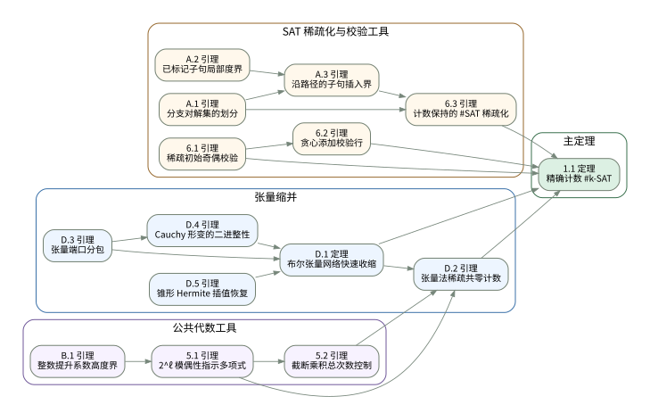

# 指数时间假设论文证明导航

## 计数问题与主结果

固定整数 $k\ge2$。给定有 $n$ 个声明变量、$m$ 个子句的 $k$-CNF 公式 $F$，目标是精确计算满足赋值数

$$\#F=\bigl|\{x\in\{0,1\}^n:F(x)=1\}\bigr|.$$

声明变量包括没有出现在子句中的变量。计数为正当且仅当公式可满足，因此精确计数也提供 SAT 判定接口。

[[1.1|定理 1.1]] 给出确定性次指数时间、多项式空间算法。对于 $n\ge20$，一般输入的运行时间为 $(n+m)^{O_k(1)}2^{O_k(n\log\log n/\sqrt{\log n})}$；若另固定常数 $D>0$ 且 $m\le Dn$，运行时间为 $(n+m)^{O_{k,D}(1)}2^{O_{k,D}(n/\sqrt{\log n})}$。该节点给出定理的条件和完整证明，分别推导一般输入和线性子句数输入的时间界。

## 证明依赖图

图中有 15 个节点、19 条连线，分为公共代数工具、SAT 稀疏化与校验工具、张量缩并和主定理四部分。箭头从前置结果指向使用它的结果。下方阅读路线列出各节点的页面链接。

图外的定义与非编号论证同样重要：[[foundations-sat-counting|SAT 计数与归约接口]] 说明计数任务，[[notation|记号与全局约定]] 集中说明符号；[[D.1|张量缩并定理]] 页面包括系数环、模态、子网络及递归成本。连线含义见 [[dependency-graph|证明依赖图说明]]。

## 主定理证明路线

- [[route-b|主定理证明路线]]：先建立布尔张量网络的有限精度缩并算法，再分别处理固定密度与一般密度的 CNF 输入。
- [[shared-algebra|公共代数工具]]：对 $\mathbb F_2$ 系数多项式方程组和整数 $\ell\ge1$，构造低总次数整数多项式。在布尔公共零点处，其值模 $2^\ell$ 等于 1；在其他布尔赋值处，其值模 $2^\ell$ 等于 0。这些工具用于 [[D.2|稀疏方程的张量编码]]。
- [[shared-sat|SAT 稀疏化与奇偶校验]]：将输入 $k$-CNF 的满足赋值集合分解为叶公式满足赋值集合的不交并；叶公式仍为 $k$-CNF，且每个变量的出现次数受限。每个赋值给出一个子句违反指示位向量：被违反的子句对应位为 1，其余位为 0。选择作用于这些向量的奇偶校验，使通过全部校验的赋值恰好是叶公式的满足赋值。
- [[outputs|主定理的两个时间界]]：汇总固定密度与一般密度的精确计数界及多项式空间保证。

## 阅读路线

### 起点：对象、目标与记号

先读 [[1.1|主定理]] 的输入、输出和时间空间界，再读 [[foundations-sat-counting|SAT 计数与归约接口]]；符号约定可查 [[notation]]。区分两个任务：计算 CNF 的满足赋值数，以及计算 $\mathbb F_2$ 系数多项式方程组在布尔赋值域中的公共零点数。[[D.2]] 实现后一个任务，[[6.2]] 在选择校验时调用它。

### 第一步：建立张量缩并算法

1. 阅读 [[D.1|张量缩并定理]] 的输入输出接口及 [[D.1#^subsec-tensor-arithmetic|系数环与精确算术]]。
2. 按 [[D.3|端口分包]]、[[D.4|Cauchy 变形的局部整性]]、[[D.5|渐变 Hermite 恢复]] 阅读局部结果。
3. 回到 D.1 中的 [[D.1#^subsec-tensor-modes|模态]]、[[D.1#^subsec-tensor-children|子网络]] 和 [[D.1#^subsec-tensor-cost|递归成本]]，完成缩并算法的证明。

### 第二步：固定密度输入

当密度常数 $D>0$ 固定且 $m\le Dn$ 时，[[1.1#^proof-thm-main-fixed-density|固定密度证明]] 直接把 CNF 编码为布尔张量网络，再调用 D.1。这个分支不需要先将公式稀疏化，也不经过 D.2 的多项式方程编码。

### 第三步：一般密度输入

1. **稀疏方程计数。** 先读 [[5.1|奇偶示性多项式]]、[[B.1|系数大小与构造成本]]、[[5.2|总阶截断]]，再读 [[D.2|稀疏方程到张量网络的编码]]；D.2 调用已经建立的 D.1。
2. **不交分解。** 按 [[A.1|单步分支]]、[[A.2|已标记子句的局部度]]、[[A.3|路径上的插入次数]]、[[6.3|不交稀疏化]] 阅读分支树证明。
3. **选择校验。** 阅读 [[parity-check-reduction|奇偶检验归约]]、[[6.1|初始校验]]、[[6.2|追加校验]]。每次候选比较都调用 D.2，最后得到每个叶公式的精确计数。
4. **合并资源界。** 回到 [[1.1#^proof-thm-main-arbitrary-density|一般密度证明]]，核对参数、叶计数累加及总时间和空间。

各命题节点直接呈现其陈述和证明。独立的 [[reading-route|阅读路线页]] 与 [[dependency-graph|证明依赖图说明页]] 保留为导航入口。
